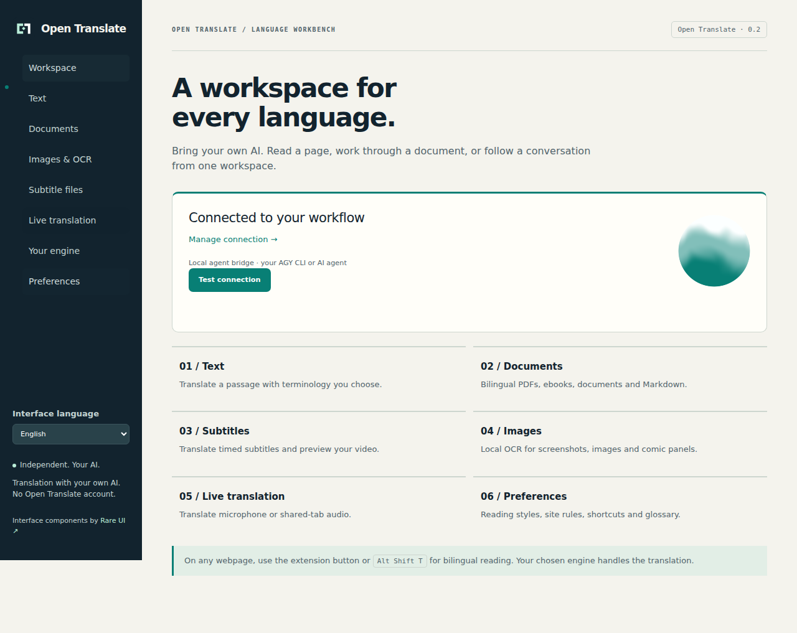

# Open Translate

Don’t let language stand between you and the world.

[中文](README.md) · [English](README.en.md) · [Français](README.fr.md) · [Español](README.es.md) · [日本語](README.ja.md) · [한국어](README.ko.md)

Read foreign-language webpages with your own AI, and translate PDFs, ebooks, images and subtitles. Open Translate is an independent browser extension that connects to a local or hosted OpenAI-compatible Chat Completions endpoint. An optional Python bridge lets you use your signed-in Google Antigravity CLI (AGY).

You do not need an Open Translate account. The project has no subscription service or telemetry; your model provider may charge for usage. The interface supports Chinese, English, French, Spanish, Japanese and Korean. Change it under “Interface language” in the popup or workspace.



## Install in Chrome or Edge

Building requires Node.js 22+ and npm. You do not need Node.js to run the installed extension.

```bash
git clone https://github.com/jpeng11/open-translate.git
cd open-translate
npm ci
npm run build
```

1. Open `chrome://extensions` or `edge://extensions` and enable developer mode.
2. Choose “Load unpacked”: select `dist/chrome` for Chrome or `dist/edge` for Edge.
3. Open the extension popup and click the engine name under `Your engine`.
4. Choose `OpenAI-compatible endpoint`, enter the API URL, model name and optional API key, then click `Save & test`.
5. Set your target language in the popup or `Preferences`. Open a webpage and click `Translate this page`.

This is a developer installation. The extension has not been published to browser stores. The build also creates ZIP archives, such as `dist/open-translate-chrome.zip`; extract them before using “Load unpacked”.

An API URL can be `http://127.0.0.1:1234/v1` or `https://your-agent.example/v1`. A complete URL ending in `/chat/completions` also works. Use the model name served by your endpoint. If it rejects `response_format`, turn off `Request JSON mode`; responses must still follow the translation JSON protocol, and tool calls cannot replace translation results. See the [architecture](docs/architecture.md).

## Use your AGY CLI

From the repository directory, start the bridge on the computer where you have signed in to `agy`. Python 3.10+ is required.

```bash
python3 -m open_translate --backend agy --timeout 180 --check
python3 -m open_translate --backend agy --timeout 180
```

In the workspace’s `Your engine` page, choose `Local bridge` and paste the complete translation URL printed in the terminal, including its private token. Set the request timeout to at least 210 seconds. Start with one paragraph per batch for a slow CLI model. You can import an existing `extension-config.json` instead.

The bridge must run on the browser’s computer or be reachable through a private tunnel you configure. The CLI keeps its existing login and tool permissions; use an agent profile intended for translation. See [Mac setup](docs/mac-setup.md) and the [bridge reference](docs/bridge.md).

## What you can translate

| Content | Available features |
| --- | --- |
| Webpages | Bilingual or translation-only view, inline links and formatting, dynamic paragraphs, source restoration and per-site rules |
| Selections and inputs | Selection translation, a hovered-paragraph shortcut, input translation, context menus, copy and browser text-to-speech |
| Documents | Import, translate and download TXT, Markdown, HTML, DOCX and EPUB |
| PDF | Text extraction, scanned-page OCR and preview; bilingual exports alternate original and translated pages |
| Images | Image or webpage-area OCR, local background repair, translated overlays and PNG downloads |
| Subtitles | SRT, VTT and ASS timing retention, bilingual downloads, local-video preview and accessible website captions |
| Live audio | Permission-based microphone or shared-tab capture, transcription through your speech endpoint, translation and transcript export |

Shortcuts: `Alt Shift T` for the page, `Alt Shift S` for selected text, `Alt Shift I` for the focused input, and `Alt Shift H` for the hovered paragraph. Change them at `chrome://extensions/shortcuts`.

OCR runs locally with bundled English, Chinese and Japanese models. Another 121 language packs are downloaded on demand, verified and cached. Speech recognition can use your `/audio/transcriptions` endpoint or local whisper.cpp through the bridge; see [local speech setup](docs/local-speech.md). Recording begins only after you click Start and grant browser permission.

## Browsers and phones

| Platform | Current status |
| --- | --- |
| Desktop Chrome / Chromium | Actual MV3 extension acceptance passed |
| Desktop Edge | Compatible package built; branded Edge runtime acceptance pending |
| Desktop Firefox | Temporary-extension acceptance passed; distribution requires signing |
| macOS / iOS Safari | Extension package and Xcode workflow available; host compilation passed, extension runtime acceptance pending |
| Android Firefox | Compatibility configuration included; signed distribution and phone testing pending |

There is no ready-to-install mobile release yet. A phone can reach a hosted AI through its accessible endpoint; reaching AGY on your computer requires a private tunnel. On a phone, `127.0.0.1` refers to the phone itself, so the computer’s localhost URL will not work unchanged. See [browser support](docs/browser-support.md) for installation and platform limits.

## Where your data goes

Document parsing and OCR happen locally. Extracted text goes to your chosen translation provider, and live audio goes to your configured speech provider. Providers may retain requests; choose one suitable for the content you process.

API credentials stay in trusted extension storage and are excluded from page-facing settings messages. They do not have operating-system keychain encryption: someone with access to your browser profile may be able to read them.

The `<all_urls>` permission lets the extension read pages for translation, reach your configured endpoints and capture webpage regions when you request it. Local file translation also requires `Allow access to file URLs` in the browser’s extension settings. The extension loads no remote scripts.

Persistent translation caching is off by default. When enabled, source and translated batch results remain on your device for up to seven days; `Clear translation cache` removes them. The running engine also keeps a bounded memory cache.

## Results and limits

Complex PDFs, unusual fonts, comic backgrounds and handwriting still need review. Bilingual PDFs retain vector content on original pages. Translated pages combine page images with searchable text, continue overflow onto extra pages and include an HTML copy with logical text order. DOCX/EPUB structure retention has tests, but layout has not been qualified in Word, LibreOffice or ebook readers. See [document fidelity](docs/document-fidelity.md).

Browser settings, extension stores, protected viewers, DRM video and inaccessible player captions may be unavailable for translation. Live audio uses segments of 2 to 5 seconds, with additional model and network latency. The [media report](docs/media-acceptance.md) describes the tested scope.

Documents are limited to 30 MiB, expanded archives to 100 MiB, PDFs to 200 pages and request batches to 20,000 characters. Cancellation prevents subsequent requests; an in-flight provider request may still finish.

The complete acceptance run on 2026-10-12 passed 64 Node, 39 Python and 49 Chromium tests, plus actual Firefox extension checks. Public-page coverage includes Wikipedia, MDN, GitHub, W3C and WHATWG, with a separate real AGY check on a Mac. The [acceptance record](docs/validation.md) identifies scope and build hashes. These results do not establish translation quality for every website or model.

## Development and documentation

```bash
npm ci
npx playwright install chromium firefox
npm run acceptance
npm run acceptance:verify
```

`acceptance` runs unit tests, builds and desktop browser acceptance. `acceptance:verify` checks that existing reports match the current source, tests and build. Reports may need regenerating after a rebuild or a platform change. Live AI endpoint checks run separately and consume your provider allowance.

[Architecture](docs/architecture.md) · [Feature scope](docs/replacement-scope.md) · [Behavior contract](docs/accepted-behavior.md) · [Visual system](docs/visual-identity.md) · [README maintenance](docs/readme-maintenance.md)

## License

Original project code is [MIT](LICENSE). The interface uses [Rare UI](https://rareui.com) components under separate [MIT + Commons Clause + Attribution](extension/ui/rare/LICENSE) terms, so the complete distribution is not MIT-only. Other dependencies retain their own licenses; builds include third-party notices.

Open Translate is independently implemented, is not affiliated with Immersive Translate and does not distribute its proprietary extension code. [Research notes](docs/reverse-engineering.md) document the implementation references.
