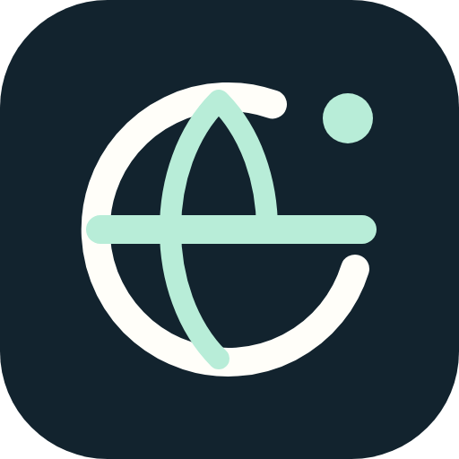
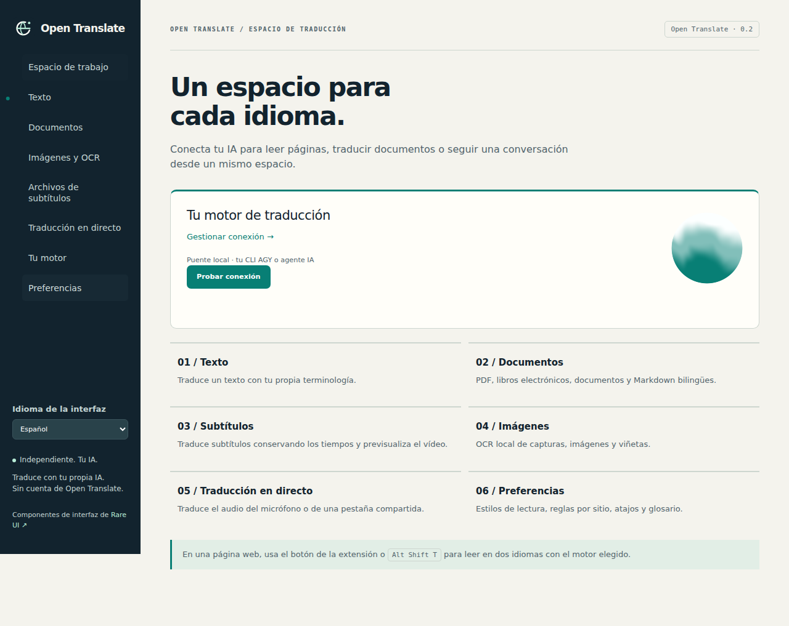

<p align="center"></p>

# Open Translate

No dejes que el idioma te impida descubrir el mundo.

[中文](README.md) · [English](README.en.md) · [Français](README.fr.md) · [Español](README.es.md) · [日本語](README.ja.md) · [한국어](README.ko.md)

Lee páginas en otros idiomas con tu propia IA y traduce PDF, libros electrónicos, imágenes y subtítulos. Open Translate es una extensión de navegador independiente que se conecta a una API Chat Completions compatible con OpenAI, local o alojada. Un puente opcional en Python permite usar Google Antigravity CLI (AGY) con tu sesión ya iniciada.

No necesitas una cuenta de Open Translate. El proyecto no tiene suscripciones ni recopila telemetría; tu proveedor de modelos puede cobrar por el uso. La interfaz permite elegir chino, inglés, francés, español, japonés o coreano. Puedes cambiarla en «Idioma de la interfaz», en el panel o el espacio de trabajo.



## Instalar en Chrome o Edge

Para compilar necesitas Node.js 22+ y npm. La extensión instalada no necesita Node.js para funcionar.

```bash
git clone https://github.com/jpeng11/open-translate.git
cd open-translate
npm ci
npm run build
```

1. Abre `chrome://extensions` o `edge://extensions` y activa el modo de desarrollador.
2. Pulsa «Cargar descomprimida» y selecciona `dist/chrome` para Chrome o `dist/edge` para Edge.
3. Abre el panel de la extensión y pulsa el nombre del motor situado bajo “Tu motor”.
4. Elige “API compatible con OpenAI · local o alojada”, introduce la URL de la API, el nombre del modelo y la clave API si hace falta, y pulsa “Guardar y probar”.
5. Selecciona el idioma de destino en el panel o en “Preferencias”. Abre una página y pulsa “Traducir esta página”.

Esta instalación usa el modo de desarrollador. La extensión aún no está publicada en las tiendas de los navegadores. La compilación también genera archivos ZIP, como `dist/open-translate-chrome.zip`; debes descomprimirlos antes de cargarlos.

Puedes usar una URL como `http://127.0.0.1:1234/v1` o `https://your-agent.example/v1`. También se admite la URL completa terminada en `/chat/completions`. El nombre del modelo debe coincidir con el que ofrece tu servidor. Si rechaza `response_format`, desactiva “Solicitar modo JSON”; aun así, las respuestas deben seguir el protocolo JSON de traducción. Una llamada a herramientas no sustituye al resultado de la traducción. Consulta la [arquitectura](docs/architecture.md).

## Usar tu CLI AGY

Desde el directorio del repositorio, inicia el puente en el ordenador donde hayas iniciado sesión en `agy`. Necesitas Python 3.10+.

```bash
python3 -m open_translate --backend agy --timeout 180 --check
python3 -m open_translate --backend agy --timeout 180
```

En la página “Tu motor”, elige “Puente local · AGY o tu agente” y pega la URL de traducción completa que aparece en el terminal, incluido el token privado. Configura un tiempo de espera de al menos 210 segundos. Para un modelo CLI lento, empieza con un párrafo por lote. También puedes importar un archivo `extension-config.json` existente.

El puente debe ejecutarse en el mismo ordenador que el navegador, o ser accesible mediante un túnel privado que configures. El CLI conserva su sesión y sus permisos para usar herramientas; conviene emplear un perfil de agente dedicado a traducir. Consulta la [configuración en Mac](docs/mac-setup.md) y la [referencia del puente](docs/bridge.md).

## Qué puedes traducir

| Contenido | Funciones |
| --- | --- |
| Páginas web | Vista bilingüe o solo traducción, enlaces y formato en línea, párrafos dinámicos, restauración del original y reglas por sitio |
| Selecciones y campos de texto | Traducción de la selección, atajo para el párrafo bajo el cursor, traducción de campos, menús contextuales, copia y lectura en voz alta del navegador |
| Documentos | Importación, traducción y descarga de TXT, Markdown, HTML, DOCX y EPUB |
| PDF | Extracción de texto, OCR de páginas escaneadas y vista previa; los archivos bilingües alternan páginas originales y traducidas |
| Imágenes | OCR de imágenes o áreas de una página, reparación local del fondo, texto traducido superpuesto y descarga PNG |
| Subtítulos | Conservación de tiempos en SRT, VTT y ASS, descarga bilingüe, vista previa con vídeo local y subtítulos web accesibles |
| Audio en directo | Captura autorizada del micrófono o de una pestaña compartida, transcripción mediante tu servicio de voz, traducción y exportación del texto |

Atajos: `Alt Shift T` para la página, `Alt Shift S` para la selección, `Alt Shift I` para el campo activo y `Alt Shift H` para el párrafo bajo el cursor. Puedes cambiarlos en `chrome://extensions/shortcuts`.

El OCR se ejecuta localmente e incluye modelos de inglés, chino y japonés. Otros 121 paquetes de idiomas se descargan bajo demanda, se verifican y se guardan en caché. El reconocimiento de voz puede usar tu API `/audio/transcriptions` o whisper.cpp local mediante el puente; consulta la [configuración de voz local](docs/local-speech.md). La grabación solo empieza después de pulsar el botón de inicio y conceder permiso al navegador.

## Navegadores y móviles

| Plataforma | Estado actual |
| --- | --- |
| Chrome / Chromium de escritorio | Pruebas de la extensión MV3 en funcionamiento superadas |
| Edge de escritorio | Paquete compatible generado; faltan las pruebas en Edge |
| Firefox de escritorio | Pruebas de extensión temporal superadas; la distribución requiere firma |
| Safari en macOS / iOS | Paquete y procedimiento de Xcode disponibles; aplicaciones contenedoras compiladas, pruebas de ejecución de la extensión pendientes |
| Firefox para Android | Configuración de compatibilidad incluida; distribución firmada y pruebas en móvil pendientes |

Todavía no hay una versión móvil lista para instalar. El teléfono puede conectarse a una API de IA alojada que sea accesible; para usar AGY en tu ordenador necesita un túnel privado. En el teléfono, `127.0.0.1` apunta al propio teléfono, por lo que no puedes reutilizar sin cambios la dirección local del ordenador. Consulta la [compatibilidad de navegadores](docs/browser-support.md).

## Adónde van tus datos

El análisis de documentos y el OCR se realizan en tu dispositivo. El texto extraído se envía al proveedor de traducción elegido, y el audio al servicio de voz configurado. Los proveedores pueden conservar las solicitudes; elige uno adecuado para el contenido que vas a procesar.

Las credenciales de API permanecen en el almacenamiento de confianza de la extensión y se excluyen de los mensajes de configuración enviados a las páginas. No tienen cifrado de llavero del sistema: alguien con acceso al perfil del navegador podría leerlas.

El permiso `<all_urls>` permite leer las páginas que quieres traducir, acceder a tus API y capturar áreas de una página cuando lo solicitas. Para traducir archivos locales también hay que activar el acceso a las URL de archivos en los ajustes de la extensión. No se cargan scripts remotos.

La caché persistente de traducciones está desactivada de forma predeterminada. Si la activas, los resultados por lotes, incluido el texto original, se guardan en el dispositivo durante un máximo de siete días. “Borrar caché de traducción” los elimina. El motor también mantiene una caché limitada en memoria mientras está funcionando.

## Resultados y límites

Los PDF complejos, las fuentes poco habituales, los fondos de cómic y la escritura a mano todavía necesitan revisión. Los PDF bilingües conservan el contenido vectorial de las páginas originales. Las páginas traducidas combinan una imagen de la página con texto que se puede buscar; los textos que no caben continúan en páginas adicionales. Se incluye una copia HTML con el orden lógico del texto. Hay pruebas de conservación de la estructura DOCX/EPUB, pero no se ha validado la maquetación en Word, LibreOffice ni lectores de libros electrónicos. Consulta la [fidelidad de documentos](docs/document-fidelity.md).

Las páginas de ajustes, las tiendas de extensiones, los visores protegidos, los vídeos con DRM y los subtítulos internos inaccesibles pueden quedar fuera de la traducción. El audio en directo se procesa en segmentos de 2 a 5 segundos, más la latencia del modelo y de la red. El [informe multimedia](docs/media-acceptance.md) detalla el alcance probado.

El límite es de 30 MiB por documento, 100 MiB por archivo descomprimido, 200 páginas por PDF y 20.000 caracteres por lote de solicitudes. Cancelar impide nuevas solicitudes; una ya enviada al proveedor puede terminar.

La validación completa del 2026-10-12 superó 66 pruebas Node, 39 Python y 51 Chromium, además de las comprobaciones de la extensión en Firefox. Las páginas públicas probadas incluyen Wikipedia, MDN, GitHub, W3C y WHATWG, con una comprobación aparte de AGY en un Mac. El [registro de validación](docs/validation.md) recoge el alcance y los hashes de los paquetes. Estos resultados no demuestran la calidad de traducción de todos los sitios o modelos.

## Desarrollo y documentación

```bash
npm ci
npx playwright install chromium firefox
npm run acceptance
npm run acceptance:verify
```

`acceptance` ejecuta las pruebas unitarias, la compilación y las pruebas en navegadores de escritorio. `acceptance:verify` comprueba que los informes existentes coincidan con el código, las pruebas y el paquete actuales. Tras recompilar o cambiar de plataforma, puede ser necesario regenerar los informes. Las pruebas con una API de IA real se ejecutan por separado y consumen tu cuota del proveedor.

[Arquitectura](docs/architecture.md) · [Alcance funcional](docs/replacement-scope.md) · [Comportamiento acordado](docs/accepted-behavior.md) · [Identidad visual](docs/visual-identity.md) · [Mantenimiento de README](docs/readme-maintenance.md)

## Licencia

El código original del proyecto usa [MIT](LICENSE). La interfaz emplea componentes de [Rare UI](https://rareui.com) sujetos a condiciones separadas de [MIT + Commons Clause + Attribution](extension/ui/rare/LICENSE), por lo que la distribución completa no tiene únicamente licencia MIT. Las demás dependencias conservan sus propias licencias; los paquetes incluyen los avisos de terceros.

Open Translate es una implementación independiente, no está afiliada a Immersive Translate y no distribuye su código de extensión propietario. Las [notas de investigación](docs/reverse-engineering.md) documentan las referencias utilizadas.
