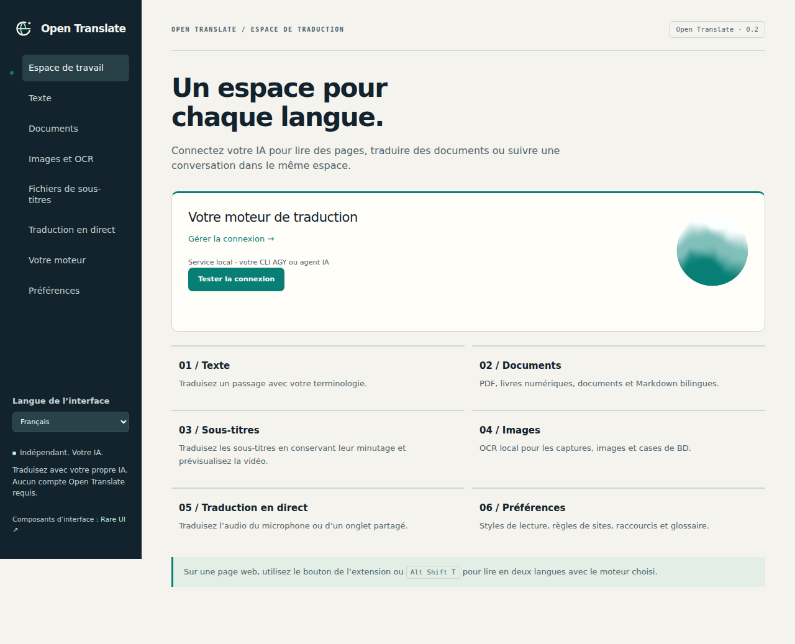

# Open Translate

Ne laissez pas la langue vous couper du monde.

[中文](README.md) · [English](README.en.md) · [Français](README.fr.md) · [Español](README.es.md) · [日本語](README.ja.md) · [한국어](README.ko.md)

Lisez des pages dans une autre langue avec votre propre IA, et traduisez des PDF, des livres numériques, des images ou des sous-titres. Open Translate est une extension de navigateur indépendante. Elle se connecte à une API Chat Completions compatible OpenAI, locale ou hébergée. Un service Python facultatif permet aussi d’utiliser Google Antigravity CLI (AGY) avec votre session existante.

Aucun compte Open Translate n’est nécessaire. Le projet ne propose pas d’abonnement et ne collecte pas de télémétrie ; les frais éventuels du fournisseur de modèles restent à votre charge. L’interface propose le chinois, l’anglais, le français, l’espagnol, le japonais et le coréen. Choisissez la langue dans « Langue de l’interface », dans le panneau ou l’espace de travail.



## Installer dans Chrome ou Edge

La compilation demande Node.js 22+ et npm. Node.js n’est plus nécessaire pour utiliser l’extension installée.

```bash
git clone https://github.com/jpeng11/open-translate.git
cd open-translate
npm ci
npm run build
```

1. Ouvrez `chrome://extensions` ou `edge://extensions` et activez le mode développeur.
2. Choisissez « Charger l’extension non empaquetée », puis `dist/chrome` pour Chrome ou `dist/edge` pour Edge.
3. Ouvrez le panneau de l’extension et cliquez sur le nom du moteur sous “Votre moteur”.
4. Sélectionnez “API compatible OpenAI · locale ou hébergée”, indiquez l’URL de l’API, le nom du modèle et, si nécessaire, la clé API, puis cliquez sur “Enregistrer et tester”.
5. Choisissez la langue cible dans le panneau ou dans “Préférences”. Ouvrez une page et cliquez sur “Traduire cette page”.

Cette installation passe par le mode développeur. L’extension n’est pas encore publiée dans les boutiques des navigateurs. La compilation crée aussi des archives ZIP, dont `dist/open-translate-chrome.zip` ; décompressez-les avant de charger l’extension.

L’URL de l’API peut être `http://127.0.0.1:1234/v1` ou `https://your-agent.example/v1`. Une URL complète se terminant par `/chat/completions` est également acceptée. Le nom du modèle doit correspondre à celui que fournit votre serveur. Si celui-ci refuse `response_format`, désactivez “Demander le mode JSON”. Les réponses doivent malgré tout respecter le protocole JSON de traduction ; un appel d’outil ne remplace pas le résultat attendu. Voir l’[architecture](docs/architecture.md).

## Utiliser votre CLI AGY

Depuis le répertoire du dépôt, démarrez le service de liaison sur l’ordinateur où vous êtes connecté à `agy`. Python 3.10+ est requis.

```bash
python3 -m open_translate --backend agy --timeout 180 --check
python3 -m open_translate --backend agy --timeout 180
```

Dans la page “Votre moteur”, choisissez “Service local · AGY ou votre agent” et collez l’URL de traduction complète affichée dans le terminal, jeton privé compris. Réglez le délai maximal d’une requête à au moins 210 secondes. Pour un modèle CLI lent, commencez par un paragraphe par lot. Vous pouvez aussi importer un fichier `extension-config.json` existant.

Le service doit tourner sur le même ordinateur que le navigateur, ou être accessible par un tunnel privé que vous configurez. Le CLI conserve sa connexion et ses autorisations d’outils ; utilisez de préférence un profil d’agent consacré à la traduction. Consultez la [configuration Mac](docs/mac-setup.md) et la [documentation du service de liaison](docs/bridge.md).

## Contenus pris en charge

| Contenu | Fonctions |
| --- | --- |
| Pages web | Affichage bilingue ou traduction seule, liens et mise en forme en ligne, paragraphes dynamiques, restauration du texte original et règles par site |
| Sélections et champs de saisie | Traduction de la sélection, raccourci pour le paragraphe survolé, traduction des champs, menus contextuels, copie et lecture vocale du navigateur |
| Documents | Importation, traduction et téléchargement de fichiers TXT, Markdown, HTML, DOCX et EPUB |
| PDF | Extraction du texte, OCR des pages numérisées et aperçu ; les exports bilingues alternent pages originales et traduites |
| Images | OCR d’images ou de zones de page web, réparation locale de l’arrière-plan, texte traduit en surimpression et export PNG |
| Sous-titres | Conservation du minutage SRT, VTT et ASS, export bilingue, aperçu avec une vidéo locale et sous-titres de sites accessibles |
| Audio en direct | Capture autorisée du microphone ou d’un onglet partagé, transcription par votre service vocal, traduction et export de la transcription |

Raccourcis : `Alt Shift T` pour la page, `Alt Shift S` pour la sélection, `Alt Shift I` pour le champ actif et `Alt Shift H` pour le paragraphe survolé. Vous pouvez les modifier dans `chrome://extensions/shortcuts`.

L’OCR fonctionne localement avec les modèles anglais, chinois et japonais inclus. Les 121 autres packs de langues se téléchargent à la demande, puis sont vérifiés et mis en cache. La reconnaissance vocale peut utiliser votre API `/audio/transcriptions` ou whisper.cpp en local via le service de liaison. Voir la [configuration vocale locale](docs/local-speech.md). L’enregistrement commence uniquement après un clic sur le bouton de démarrage et l’autorisation du navigateur.

## Navigateurs et téléphones

| Plateforme | État actuel |
| --- | --- |
| Chrome / Chromium sur ordinateur | Tests de l’extension MV3 en fonctionnement réussis |
| Edge sur ordinateur | Paquet compatible compilé ; validation dans Edge encore à effectuer |
| Firefox sur ordinateur | Tests d’une extension temporaire réussis ; signature nécessaire pour la distribution |
| Safari sur macOS / iOS | Paquet et procédure Xcode disponibles ; applications hôtes compilées, validation de l’extension en fonctionnement encore à effectuer |
| Firefox sur Android | Configuration de compatibilité incluse ; distribution signée et tests sur téléphone encore à effectuer |

Il n’existe pas encore de version mobile prête à installer. Un téléphone peut utiliser une API d’IA hébergée accessible ; pour joindre AGY sur votre ordinateur, il faut un tunnel privé. Sur le téléphone, `127.0.0.1` désigne le téléphone lui-même : l’adresse locale de l’ordinateur ne peut donc pas être reprise telle quelle. Les détails d’installation figurent dans la [documentation des navigateurs](docs/browser-support.md).

## Où vont vos données

L’analyse des documents et l’OCR se font sur votre appareil. Le texte extrait part vers le fournisseur de traduction choisi, et l’audio vers le service de transcription configuré. Ces fournisseurs peuvent conserver les requêtes ; choisissez-les selon la nature des contenus traités.

Les identifiants API restent dans le stockage réservé à l’extension et sont exclus des messages de paramètres transmis aux pages. Ils ne bénéficient pas d’un chiffrement de type trousseau système : une personne ayant accès au profil du navigateur peut éventuellement les lire.

L’autorisation `<all_urls>` permet de lire les pages à traduire, de joindre vos API et de capturer une zone de page à votre demande. Pour traduire des fichiers locaux, activez aussi l’accès aux URL de fichiers dans les paramètres de l’extension. Aucun script distant n’est chargé.

Le cache persistant des traductions est désactivé par défaut. Si vous l’activez, les résultats par lots, texte source compris, restent sur l’appareil pendant sept jours au maximum. “Vider le cache de traduction” les supprime. Le moteur conserve aussi un cache mémoire de taille limitée pendant son exécution.

## Résultats et limites

Les PDF complexes, les polices inhabituelles, les décors de bandes dessinées et l’écriture manuscrite nécessitent encore une vérification. Les PDF bilingues conservent les éléments vectoriels des pages originales. Les pages traduites associent une image de la page à du texte recherchable ; les passages trop longs continuent sur des pages supplémentaires. Une copie HTML conserve l’ordre logique du texte. La préservation de la structure DOCX/EPUB est testée, mais la mise en page n’a pas été validée dans Word, LibreOffice ou les liseuses. Voir la [fidélité des documents](docs/document-fidelity.md).

Les pages de paramètres, les boutiques d’extensions, les lecteurs protégés, les vidéos DRM et les sous-titres internes inaccessibles peuvent échapper à la traduction. L’audio en direct est traité par segments de 2 à 5 secondes, auxquels s’ajoute la latence du modèle et du réseau. Le [rapport multimédia](docs/media-acceptance.md) précise le périmètre testé.

Les limites sont de 30 MiB par document, 100 MiB pour une archive décompressée, 200 pages par PDF et 20 000 caractères par lot de requête. L’annulation empêche les requêtes suivantes ; une requête déjà envoyée au fournisseur peut se terminer.

La validation complète du 2026-10-12 a réussi 66 tests Node, 39 tests Python et 51 tests Chromium, ainsi que les vérifications de l’extension dans Firefox. Les pages publiques testées proviennent de Wikipedia, MDN, GitHub, W3C et WHATWG. Un contrôle séparé a utilisé AGY sur un Mac. Le [rapport de validation](docs/validation.md) indique le périmètre et les empreintes des paquets ; ces résultats ne mesurent pas la qualité de traduction de tous les sites ou modèles.

## Développement et documentation

```bash
npm ci
npx playwright install chromium firefox
npm run acceptance
npm run acceptance:verify
```

`acceptance` lance les tests unitaires, la compilation et les tests dans les navigateurs de bureau. `acceptance:verify` vérifie que les rapports existants correspondent au code, aux tests et au paquet actuels. Une nouvelle compilation ou un changement de plateforme peut nécessiter de nouveaux rapports. Les contrôles avec une véritable API d’IA se lancent séparément et consomment votre quota fournisseur.

[Architecture](docs/architecture.md) · [Périmètre fonctionnel](docs/replacement-scope.md) · [Comportements retenus](docs/accepted-behavior.md) · [Identité visuelle](docs/visual-identity.md) · [Maintenance des README](docs/readme-maintenance.md)

## Licence

Le code original du projet est sous licence [MIT](LICENSE). L’interface utilise des composants [Rare UI](https://rareui.com), soumis à leurs propres conditions [MIT + Commons Clause + Attribution](extension/ui/rare/LICENSE). La distribution complète ne relève donc pas uniquement de MIT. Les autres dépendances conservent leurs licences ; les paquets incluent les mentions tierces.

Open Translate est une implémentation indépendante, sans affiliation à Immersive Translate, et ne distribue pas son code d’extension propriétaire. Les [notes de recherche](docs/reverse-engineering.md) indiquent les références utilisées pour l’implémentation.
