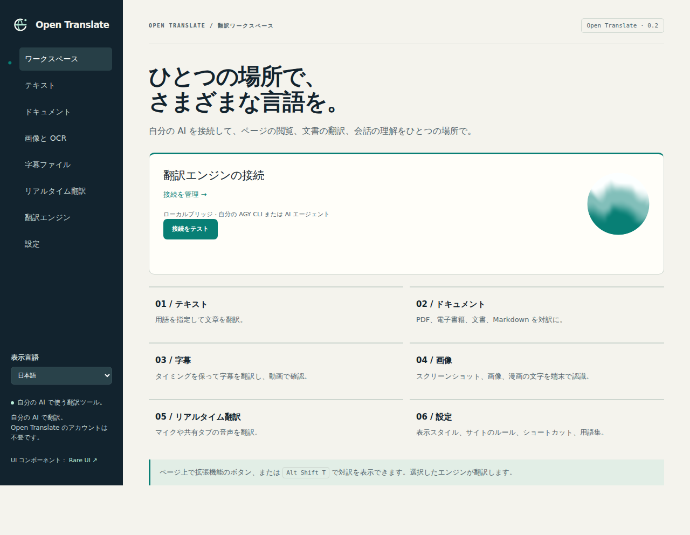

<p align="center"></p>

# Open Translate

言葉の壁を越えて、世界を見よう。

[中文](README.md) · [English](README.en.md) · [Français](README.fr.md) · [Español](README.es.md) · [日本語](README.ja.md) · [한국어](README.ko.md)

自分の AI で外国語のウェブページを読み、PDF、電子書籍、画像、字幕を翻訳できます。Open Translate は独立したブラウザ拡張機能です。ローカルまたはクラウドの OpenAI 互換 Chat Completions API に接続します。Python ブリッジを使えば、ログイン済みの Google Antigravity CLI（AGY）でも翻訳できます。

Open Translate のアカウントは不要です。プロジェクト独自のサブスクリプションやテレメトリー収集はありません。モデル提供元の利用料金は、自分のアカウントに課金されます。表示言語は中国語、英語、フランス語、スペイン語、日本語、韓国語から選べます。ポップアップまたはワークスペースの「表示言語」で変更できます。



## Chrome または Edge にインストールする

ビルドには Node.js 22+ と npm が必要です。インストールした拡張機能の実行には Node.js は不要です。

```bash
git clone https://github.com/jpeng11/open-translate.git
cd open-translate
npm ci
npm run build
```

1. `chrome://extensions` または `edge://extensions` を開き、デベロッパーモードを有効にします。
2. 展開済みの拡張機能を読み込む操作で、Chrome では `dist/chrome`、Edge では `dist/edge` を選びます。
3. 拡張機能のポップアップを開き、「翻訳エンジン」の下にあるエンジン名をクリックします。
4. 「OpenAI 互換 API · ローカルまたはクラウド」を選び、API の URL、モデル名、必要に応じて API キーを入力し、「保存してテスト」をクリックします。
5. ポップアップまたは「設定」で翻訳先の言語を選びます。ウェブページを開き、「このページを翻訳」をクリックします。

現在は開発者向けのインストール方法を使います。ブラウザの拡張機能ストアにはまだ公開していません。ビルド時には `dist/open-translate-chrome.zip` などの ZIP も生成されます。展開してから読み込んでください。

API の URL には `http://127.0.0.1:1234/v1` や `https://your-agent.example/v1` を指定できます。末尾が `/chat/completions` の完全な URL にも対応しています。モデル名は接続先が提供する名前を使ってください。`response_format` に対応しない API では「JSON モードを要求」をオフにします。その場合も翻訳用 JSON プロトコルに従った応答が必要で、ツール呼び出しを翻訳結果として返すことはできません。[アーキテクチャ](docs/architecture.md)に詳細があります。

## 自分の AGY CLI を使う

`agy` にログイン済みのコンピューターで、リポジトリのディレクトリからブリッジを起動します。Python 3.10+ が必要です。

```bash
python3 -m open_translate --backend agy --timeout 180 --check
python3 -m open_translate --backend agy --timeout 180
```

「翻訳エンジン」画面で「ローカルブリッジ · AGY または自分のエージェント」を選び、ターミナルに表示された翻訳 URL をプライベートトークンごと貼り付けます。リクエストのタイムアウトは 210 秒以上にしてください。遅い CLI モデルでは、1 回あたり 1 段落から始めると扱いやすくなります。既存の `extension-config.json` をインポートすることもできます。

ブリッジはブラウザと同じコンピューターで動かすか、自分で設定したプライベートトンネル経由で接続する必要があります。CLI は既存のログイン状態とツール権限を使います。翻訳専用のエージェント設定を用意してください。[Mac の設定](docs/mac-setup.md)と[ブリッジの説明](docs/bridge.md)も参照できます。

## 翻訳できる内容

| 対象 | 機能 |
| --- | --- |
| ウェブページ | 対訳または訳文のみの表示、リンクとインライン書式の保持、動的な段落、原文への復元、サイトごとのルール |
| 選択範囲と入力欄 | 選択した文字の翻訳、カーソル下の段落を翻訳するショートカット、入力欄翻訳、右クリックメニュー、コピー、ブラウザの読み上げ |
| 文書 | TXT、Markdown、HTML、DOCX、EPUB の読み込み、翻訳、ダウンロード |
| PDF | 文字の抽出、スキャンページの OCR、プレビュー。対訳出力では原文ページと訳文ページを交互に配置 |
| 画像 | 画像やページ内の範囲の OCR、背景の部分修復、訳文の重ね合わせ、PNG ダウンロード |
| 字幕 | SRT、VTT、ASS のタイミング保持、二言語字幕のダウンロード、ローカル動画での確認、アクセス可能なウェブ字幕 |
| 音声 | 許可したマイクや共有タブの音声を取得し、自分の音声 API で文字起こしして翻訳。記録の書き出しにも対応 |

ショートカットは `Alt Shift T` がページ、`Alt Shift S` が選択範囲、`Alt Shift I` が入力中の欄、`Alt Shift H` がカーソル下の段落です。`chrome://extensions/shortcuts` で変更できます。

OCR は端末上で動き、英語、中国語、日本語のモデルを同梱しています。他の 121 言語パックは必要に応じてダウンロードし、検証してキャッシュします。音声認識には自分の `/audio/transcriptions` API、またはブリッジ経由のローカル whisper.cpp を使えます。[ローカル音声認識の設定](docs/local-speech.md)を参照してください。録音は開始ボタンを押し、ブラウザで許可した後に始まります。

## ブラウザとスマートフォン

| 環境 | 現在の状態 |
| --- | --- |
| デスクトップ Chrome / Chromium | 実際の MV3 拡張機能で受け入れテスト済み |
| デスクトップ Edge | 互換パッケージを生成済み。Edge での実行テストは未完了 |
| デスクトップ Firefox | 一時的に読み込んだ拡張機能でテスト済み。配布には署名が必要 |
| macOS / iOS Safari | 拡張機能パッケージと Xcode の手順あり。ホストアプリはコンパイル済み。拡張機能の実行テストは未完了 |
| Android Firefox | 互換設定あり。署名付き配布とスマートフォン実機テストは未完了 |

そのままインストールできるモバイル版はまだありません。スマートフォンからクラウド AI を使う場合は、アクセス可能な API の URL を指定します。コンピューター上の AGY に接続するにはプライベートトンネルが必要です。スマートフォンの `127.0.0.1` はスマートフォン自身を指すため、コンピューターのローカル URL をそのまま使うことはできません。[ブラウザ対応状況](docs/browser-support.md)に手順と制限をまとめています。

## データの送信先

文書の解析と OCR は端末上で行います。抽出した翻訳対象の文字は選択した翻訳サービスへ、音声は設定した音声認識サービスへ送信します。サービス側がリクエストを保存する可能性があるため、扱う内容に合った接続先を選んでください。

API の認証情報は拡張機能専用のストレージに保存し、ページに渡す設定メッセージには含めません。OS のキーチェーン相当の暗号化は行っていないため、ブラウザプロファイルにアクセスできる人は認証情報を読める可能性があります。

`<all_urls>` 権限は、翻訳するページの読み取り、設定した API への接続、ユーザー操作によるページ範囲のキャプチャに使います。ローカルファイルの翻訳には、拡張機能の設定でファイル URL へのアクセスも許可してください。リモートスクリプトは読み込みません。

翻訳の永続キャッシュは初期設定でオフです。有効にすると原文と訳文のバッチ結果を最長 7 日間保存し、「翻訳キャッシュを削除」で消去できます。エンジンの実行中は、容量を制限したメモリーキャッシュも使います。

## 翻訳結果と制限

複雑な PDF、特殊なフォント、漫画の背景、手書き文字は確認が必要です。対訳 PDF の原文ページはベクトル要素を保持します。訳文ページはページ画像に検索可能な文字を重ね、収まらない文章を追加ページに配置します。論理的な文字順を保つ HTML も添付します。DOCX/EPUB の構造保持はテストしていますが、Word、LibreOffice、各種電子書籍リーダーでのレイアウト検証は未完了です。[文書の再現性](docs/document-fidelity.md)を参照してください。

ブラウザの設定ページ、拡張機能ストア、保護されたビューアー、DRM 動画、アクセスできないプレーヤー内部の字幕は翻訳できない場合があります。音声は 2 秒から 5 秒の区間で処理し、モデルとネットワークの遅延が加わります。[メディアの検証記録](docs/media-acceptance.md)に対象範囲を記載しています。

上限は文書 30 MiB、展開後のアーカイブ 100 MiB、PDF 200 ページ、リクエストのバッチ 20,000 文字です。キャンセルすると後続のリクエストを止めますが、送信済みのリクエストは完了する場合があります。

2026-10-12 の完全な受け入れテストでは Node 66 件、Python 39 件、Chromium 51 件と、Firefox での拡張機能テストが通りました。公開サイトは Wikipedia、MDN、GitHub、W3C、WHATWG を確認し、Mac で実際の AGY 接続も別途検証しています。対象範囲とビルドのハッシュは[検証記録](docs/validation.md)を参照してください。すべてのサイトやモデルの翻訳品質を保証する結果ではありません。

## 開発とドキュメント

```bash
npm ci
npx playwright install chromium firefox
npm run acceptance
npm run acceptance:verify
```

`acceptance` は単体テスト、ビルド、デスクトップブラウザのテストを実行します。`acceptance:verify` は既存のレポートが現在のコード、テスト、ビルドに一致するか確認します。再ビルドやプラットフォーム変更後は、レポートの再生成が必要になる場合があります。実際の AI API を使うテストは別に実行し、サービスの利用枠を消費します。

[アーキテクチャ](docs/architecture.md) · [機能範囲](docs/replacement-scope.md) · [動作方針](docs/accepted-behavior.md) · [ビジュアル設計](docs/visual-identity.md) · [README の保守](docs/readme-maintenance.md)

## ライセンス

プロジェクト独自のコードは [MIT](LICENSE) です。UI に使用している [Rare UI](https://rareui.com) コンポーネントには、別途 [MIT + Commons Clause + Attribution](extension/ui/rare/LICENSE) が適用されるため、配布物全体が MIT のみで許諾されているわけではありません。他の依存関係も各自のライセンスを保持し、ビルドには第三者のライセンス表記を含めます。

Open Translate は独立した実装で、Immersive Translate との提携関係はなく、その専有拡張機能コードを配布しません。実装の参考資料は[調査記録](docs/reverse-engineering.md)に記載しています。
