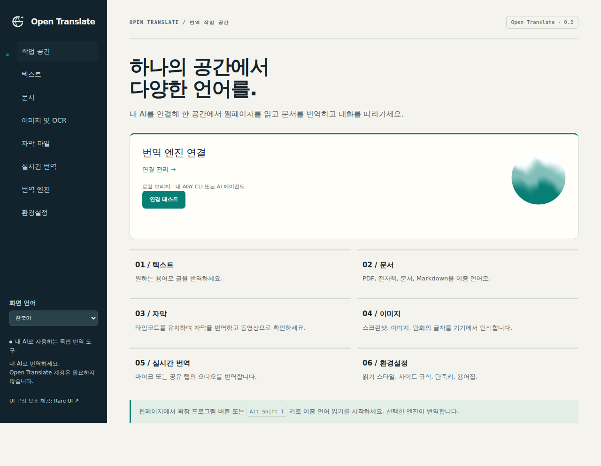

<p align="center"></p>

# Open Translate

언어의 벽을 넘어 세상을 만나세요.

[中文](README.md) · [English](README.en.md) · [Français](README.fr.md) · [Español](README.es.md) · [日本語](README.ja.md) · [한국어](README.ko.md)

내 AI로 외국어 웹페이지를 읽고 PDF, 전자책, 이미지, 자막을 번역하세요. Open Translate는 독립적인 브라우저 확장 프로그램입니다. 로컬 또는 호스팅 환경의 OpenAI 호환 Chat Completions API에 연결합니다. Python 브리지를 사용하면 로그인된 Google Antigravity CLI(AGY)로도 번역할 수 있습니다.

Open Translate 계정은 필요하지 않습니다. 프로젝트 자체 구독이나 텔레메트리 수집은 없으며, 모델 제공업체의 사용 요금은 내 계정에 청구됩니다. 화면 언어는 중국어, 영어, 프랑스어, 스페인어, 일본어, 한국어를 지원합니다. 팝업이나 작업 공간의 '화면 언어'에서 바꿀 수 있습니다.



## Chrome 또는 Edge에 설치하기

빌드하려면 Node.js 22+와 npm이 필요합니다. 설치한 확장 프로그램을 실행할 때는 Node.js가 필요하지 않습니다.

```bash
git clone https://github.com/jpeng11/open-translate.git
cd open-translate
npm ci
npm run build
```

1. `chrome://extensions` 또는 `edge://extensions`를 열고 개발자 모드를 켭니다.
2. 압축 해제된 확장 프로그램을 로드하는 메뉴에서 Chrome은 `dist/chrome`, Edge는 `dist/edge`를 선택합니다.
3. 확장 프로그램 팝업을 열고 '번역 엔진' 아래의 엔진 이름을 누릅니다.
4. 'OpenAI 호환 API · 로컬 또는 호스팅'을 선택하고 API URL, 모델 이름, 필요한 경우 API 키를 입력한 뒤 '저장 및 테스트'를 누릅니다.
5. 팝업이나 '환경설정'에서 번역 언어를 선택합니다. 웹페이지를 열고 '이 페이지 번역'을 누릅니다.

현재는 개발자 모드로 설치합니다. 브라우저 확장 프로그램 스토어에는 아직 등록하지 않았습니다. 빌드하면 `dist/open-translate-chrome.zip` 같은 ZIP 파일도 생성됩니다. 압축을 푼 뒤 로드하세요.

API URL은 `http://127.0.0.1:1234/v1` 또는 `https://your-agent.example/v1`처럼 입력합니다. `/chat/completions`로 끝나는 전체 URL도 지원합니다. 모델 이름은 서버가 제공하는 이름과 같아야 합니다. API가 `response_format`을 지원하지 않으면 'JSON 모드 요청'을 끄세요. 이 경우에도 응답은 번역 JSON 프로토콜을 따라야 하며, 도구 호출을 번역 결과 대신 반환할 수는 없습니다. 자세한 내용은 [아키텍처](docs/architecture.md)를 참고하세요.

## 내 AGY CLI 사용하기

`agy`에 로그인한 컴퓨터에서 저장소 디렉터리로 이동해 브리지를 시작합니다. Python 3.10+가 필요합니다.

```bash
python3 -m open_translate --backend agy --timeout 180 --check
python3 -m open_translate --backend agy --timeout 180
```

'번역 엔진' 화면에서 '로컬 브리지 · AGY 또는 내 에이전트'를 선택하고 터미널에 출력된 번역 URL을 비공개 토큰까지 포함해 붙여 넣습니다. 요청 제한 시간은 210초 이상으로 설정하세요. 느린 CLI 모델은 요청당 한 문단부터 시작하면 됩니다. 기존 `extension-config.json` 파일을 가져올 수도 있습니다.

브리지는 브라우저와 같은 컴퓨터에서 실행하거나 직접 설정한 비공개 터널을 통해 접근할 수 있어야 합니다. CLI는 기존 로그인 상태와 도구 권한을 그대로 사용하므로 번역용 에이전트 프로필을 사용하는 편이 좋습니다. [Mac 설정](docs/mac-setup.md)과 [브리지 설명](docs/bridge.md)을 참고하세요.

## 번역할 수 있는 내용

| 대상 | 기능 |
| --- | --- |
| 웹페이지 | 이중 언어 또는 번역문만 표시, 링크와 인라인 서식 유지, 동적 문단 처리, 원문 복원, 사이트별 규칙 |
| 선택 영역과 입력란 | 선택한 텍스트 번역, 커서 아래 문단 단축키, 입력란 번역, 우클릭 메뉴, 복사, 브라우저 읽어주기 |
| 문서 | TXT, Markdown, HTML, DOCX, EPUB 가져오기, 번역, 다운로드 |
| PDF | 텍스트 추출, 스캔 페이지 OCR, 미리 보기. 이중 언어 파일은 원문과 번역 페이지를 번갈아 배치 |
| 이미지 | 이미지나 웹페이지 영역의 OCR, 배경 부분 복원, 번역문 덧씌우기, PNG 다운로드 |
| 자막 | SRT, VTT, ASS 타임코드 유지, 이중 언어 다운로드, 로컬 동영상 미리 보기, 접근 가능한 웹 자막 |
| 실시간 오디오 | 권한을 허용한 마이크나 공유 탭을 캡처하고 내 음성 API로 텍스트 변환 후 번역. 기록 내보내기 지원 |

단축키는 페이지 번역 `Alt Shift T`, 선택 영역 번역 `Alt Shift S`, 현재 입력란 번역 `Alt Shift I`, 커서 아래 문단 번역 `Alt Shift H`입니다. `chrome://extensions/shortcuts`에서 변경할 수 있습니다.

OCR은 기기에서 실행되며 영어, 중국어, 일본어 모델이 포함되어 있습니다. 다른 121개 언어 팩은 필요할 때 내려받아 검증하고 캐시합니다. 음성 인식에는 내 `/audio/transcriptions` API나 브리지를 통한 로컬 whisper.cpp를 사용할 수 있습니다. [로컬 음성 설정](docs/local-speech.md)을 참고하세요. 녹음은 시작 버튼을 누르고 브라우저 권한을 허용한 뒤에만 시작됩니다.

## 브라우저와 휴대전화

| 플랫폼 | 현재 상태 |
| --- | --- |
| 데스크톱 Chrome / Chromium | 실제 MV3 확장 프로그램 검증 통과 |
| 데스크톱 Edge | 호환 패키지 생성 완료. Edge 실행 검증은 미완료 |
| 데스크톱 Firefox | 임시 확장 프로그램 검증 통과. 배포하려면 서명 필요 |
| macOS / iOS Safari | 확장 패키지와 Xcode 절차 제공. 호스트 앱 컴파일 완료, 확장 프로그램 실행 검증은 미완료 |
| Android Firefox | 호환 설정 포함. 서명된 배포와 휴대전화 실기기 검증은 미완료 |

바로 설치해 쓸 수 있는 모바일 버전은 아직 없습니다. 휴대전화에서 호스팅된 AI를 사용하려면 접근 가능한 API 주소를 입력하면 됩니다. 컴퓨터의 AGY에 연결하려면 비공개 터널이 필요합니다. 휴대전화의 `127.0.0.1`은 휴대전화 자체를 가리키므로 컴퓨터의 로컬 주소를 그대로 쓸 수 없습니다. 설치 방법과 제약은 [브라우저 지원](docs/browser-support.md)에 정리되어 있습니다.

## 데이터 전송과 저장

문서 분석과 OCR은 기기에서 처리합니다. 추출한 번역 대상 텍스트는 선택한 번역 서비스로, 오디오는 설정한 음성 서비스로 보냅니다. 제공업체가 요청을 보관할 수 있으니 처리할 내용에 맞는 서비스를 선택하세요.

API 인증 정보는 신뢰할 수 있는 확장 프로그램 저장소에 보관하며 웹페이지에 보내는 설정 메시지에는 포함하지 않습니다. 운영체제 키체인 수준의 암호화를 제공하지 않으므로 브라우저 프로필에 접근할 수 있는 사람은 인증 정보를 읽을 수 있습니다.

`<all_urls>` 권한은 번역할 페이지를 읽고, 설정한 API에 접속하고, 사용자가 요청한 웹페이지 영역을 캡처하는 데 사용합니다. 로컬 파일을 번역하려면 확장 프로그램 설정에서 파일 URL 접근도 허용해야 합니다. 원격 스크립트는 불러오지 않습니다.

번역의 영구 캐시는 기본적으로 꺼져 있습니다. 켜면 원문과 번역문 배치 결과를 기기에 최대 7일 동안 저장하며 '번역 캐시 지우기'로 삭제할 수 있습니다. 엔진이 실행되는 동안에는 용량이 제한된 메모리 캐시도 사용합니다.

## 결과와 제한

복잡한 PDF, 특수 글꼴, 만화 배경, 손글씨는 확인이 필요합니다. 이중 언어 PDF의 원문 페이지는 벡터 내용을 유지합니다. 번역 페이지는 페이지 이미지 위에 검색 가능한 텍스트를 넣고, 공간이 부족하면 추가 페이지로 이어집니다. 논리적 텍스트 순서를 유지하는 HTML도 포함합니다. DOCX/EPUB 구조 유지 테스트는 있지만 Word, LibreOffice, 전자책 리더의 레이아웃 검증은 아직 완료하지 않았습니다. [문서 재현성](docs/document-fidelity.md)을 참고하세요.

브라우저 설정 페이지, 확장 프로그램 스토어, 보호된 뷰어, DRM 동영상, 접근할 수 없는 플레이어 내부 자막은 번역하지 못할 수 있습니다. 실시간 오디오는 2초에서 5초 구간으로 처리하며 모델과 네트워크 지연이 추가됩니다. [미디어 검증 보고서](docs/media-acceptance.md)에 테스트 범위를 설명했습니다.

문서당 30 MiB, 압축을 푼 아카이브 100 MiB, PDF 200페이지, 요청 배치당 20,000자까지 지원합니다. 취소하면 후속 요청을 막지만 이미 전송된 요청은 완료될 수 있습니다.

2026-10-12 전체 검증에서 Node 66개, Python 39개, Chromium 51개 테스트와 실제 Firefox 확장 프로그램 검사가 통과했습니다. 공개 웹페이지는 Wikipedia, MDN, GitHub, W3C, WHATWG에서 확인했고 Mac의 실제 AGY 연결도 별도로 검증했습니다. [검증 기록](docs/validation.md)에 범위와 빌드 해시가 있습니다. 이 결과가 모든 웹사이트와 모델의 번역 품질을 입증하는 것은 아닙니다.

## 개발과 문서

```bash
npm ci
npx playwright install chromium firefox
npm run acceptance
npm run acceptance:verify
```

`acceptance`는 단위 테스트, 빌드, 데스크톱 브라우저 검증을 실행합니다. `acceptance:verify`는 기존 보고서가 현재 소스, 테스트, 빌드와 일치하는지 확인합니다. 다시 빌드하거나 플랫폼을 바꾸면 보고서를 새로 생성해야 할 수 있습니다. 실제 AI API 테스트는 별도로 실행하며 제공업체 이용 한도를 사용합니다.

[아키텍처](docs/architecture.md) · [기능 범위](docs/replacement-scope.md) · [동작 기준](docs/accepted-behavior.md) · [시각 디자인](docs/visual-identity.md) · [README 관리](docs/readme-maintenance.md)

## 라이선스

프로젝트의 자체 코드는 [MIT](LICENSE)입니다. UI의 [Rare UI](https://rareui.com) 구성 요소에는 별도의 [MIT + Commons Clause + Attribution](extension/ui/rare/LICENSE) 조건이 적용되므로 전체 배포물을 MIT 전용으로 볼 수는 없습니다. 다른 의존성도 각자의 라이선스를 유지하며 빌드 패키지에 제3자 고지가 포함됩니다.

Open Translate는 독립적인 구현이며 Immersive Translate와 제휴 관계가 없고 해당 제품의 독점 확장 프로그램 코드를 배포하지 않습니다. 구현에 참고한 내용은 [조사 기록](docs/reverse-engineering.md)에 남겨 두었습니다.
