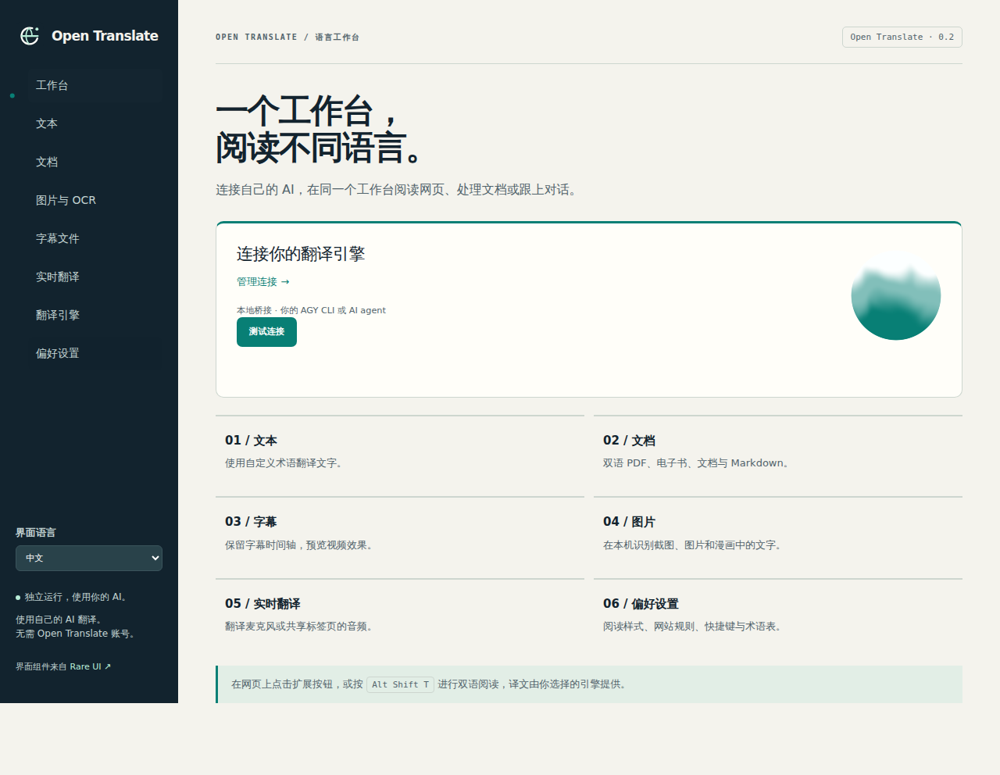

<p align="center"></p>

# Open Translate

别让语言挡住你看世界。

[中文](README.md) · [English](README.en.md) · [Français](README.fr.md) · [Español](README.es.md) · [日本語](README.ja.md) · [한국어](README.ko.md)

用自己的 AI 阅读外语网页，也能翻译 PDF、电子书、图片和字幕。Open Translate 是独立的浏览器扩展，支持本地或云端的 OpenAI-compatible Chat Completions 接口；你也可以通过 Python 桥接服务，使用已经登录的 Google Antigravity CLI（AGY）。

不需要 Open Translate 账号。项目没有订阅服务，也不采集遥测数据；模型服务商的费用仍由你的账号承担。界面支持中文、英文、法语、西班牙语、日语和韩语，可在弹窗或工作台的“界面语言”中切换。



## 安装到 Chrome 或 Edge

构建需要 Node.js 22+ 和 npm。安装完成后，运行扩展不需要 Node.js。

```bash
git clone https://github.com/jpeng11/open-translate.git
cd open-translate
npm ci
npm run build
```

1. 打开 `chrome://extensions` 或 `edge://extensions`，开启开发者模式。
2. 点击“加载已解压的扩展程序”，Chrome 选择 `dist/chrome`，Edge 选择 `dist/edge`。
3. 打开扩展弹窗，点击 “翻译引擎” 下的引擎名称。
4. 选择 “OpenAI 兼容接口 · 本地或云端”，填入 API 地址、模型名和可选的 API key，点击 “保存并测试”。
5. 在弹窗或 “偏好设置” 中设置目标语言，打开网页后点击 “翻译此页”。

这是开发者安装方式，项目尚未上架浏览器扩展商店。构建也会生成 ZIP 包，例如 `dist/open-translate-chrome.zip`；使用“加载已解压的扩展程序”前需要先解压。

API 地址可以是 `http://127.0.0.1:1234/v1` 或 `https://your-agent.example/v1`，也接受包含 `/chat/completions` 的完整地址。模型名应与接口实际提供的模型一致。如果服务不支持 `response_format`，关闭 “请求 JSON 模式”；返回内容仍须符合翻译 JSON 协议，不能以工具调用代替翻译结果。详见[架构说明](docs/architecture.md)。

## 使用自己的 AGY

在已登录 `agy` 的电脑上，从仓库目录启动桥接服务。需要 Python 3.10+。

```bash
python3 -m open_translate --backend agy --timeout 180 --check
python3 -m open_translate --backend agy --timeout 180
```

在工作台的 “翻译引擎” 页面选择 “本地桥接 · AGY 或自己的 agent”，粘贴终端打印的完整翻译 URL，包括私有 token。将请求超时设为至少 210 秒；较慢的 CLI 模型可以从每批一段开始。已有桥接配置可通过 `extension-config.json` 导入。

桥接服务需要在浏览器所在电脑上运行，或通过你配置的私有隧道访问。CLI 继续使用原有的登录状态和工具权限，建议使用专门处理翻译的 agent 配置。部署细节见 [Mac 设置](docs/mac-setup.md)和[桥接服务说明](docs/bridge.md)。

## 可以翻译什么

| 内容 | 功能 |
| --- | --- |
| 网页 | 双语或仅译文视图，保留链接和行内格式，处理动态段落，恢复原文，按网站设置规则 |
| 选中文字与输入框 | 选词翻译、段落悬停快捷键、输入框翻译、右键菜单、复制和浏览器朗读 |
| 文档 | TXT、Markdown、HTML、DOCX、EPUB 的导入、翻译和下载 |
| PDF | 提取文字、扫描页 OCR、页面预览；双语导出交替保留原文页和译文页 |
| 图片 | 图片或网页区域 OCR、局部背景修复、译文覆盖和 PNG 下载 |
| 字幕 | SRT、VTT、ASS 保留时间轴，支持双语下载、本地视频预览和可访问的网页字幕 |
| 实时音频 | 经授权采集麦克风或共享标签页音频，通过自己的语音接口转写，再翻译并导出记录 |

快捷键：`Alt Shift T` 翻译网页，`Alt Shift S` 翻译选区，`Alt Shift I` 翻译当前输入框，`Alt Shift H` 翻译鼠标所在段落。可在 `chrome://extensions/shortcuts` 调整。

OCR 在本机运行，内置英语、中文和日语模型，另有 121 个按需下载、校验并缓存的语言包。语音转写可以连接自己的 `/audio/transcriptions` 接口，也可以在桥接服务中启用本地 whisper.cpp，见[本地语音设置](docs/local-speech.md)。录音只会在点击开始并授予浏览器权限后进行。

## 浏览器与手机

| 平台 | 当前状态 |
| --- | --- |
| 桌面 Chrome / Chromium | 已通过实际 MV3 扩展验收 |
| 桌面 Edge | 已生成兼容包，Edge 实机验收尚未完成 |
| 桌面 Firefox | 已通过临时扩展验收；正式分发需要签名 |
| macOS / iOS Safari | 已有扩展包和 Xcode 工程流程，宿主工程编译通过；扩展运行验收仍待完成 |
| Android Firefox | 已有兼容配置，签名分发和手机实测尚未完成 |

手机端目前还不是可直接安装使用的正式版本。手机连接云端 AI 时可以使用可访问的接口地址；连接电脑上的 AGY 则需要私有隧道。手机上的 `127.0.0.1` 指手机自身，不能照搬电脑的本地地址。安装和平台限制见[浏览器支持](docs/browser-support.md)。

## 数据会发到哪里

文档解析和 OCR 在本机完成，提取出的待译文本发送给你选择的翻译服务；实时音频发送给你配置的语音服务。服务商可能保留请求，请按所处理的内容选择服务。

API 凭据保存在可信扩展存储中，不会通过页面设置消息发给网页脚本。它们不具备系统钥匙串级别的加密，能访问浏览器个人资料的人仍可能读取凭据。

扩展使用 `<all_urls>` 权限读取待译网页、访问用户配置的接口，并在用户操作时截取网页区域。翻译本地文件还需要在扩展管理页启用 文件网址访问权限。扩展不加载远程脚本。

持久翻译缓存默认关闭。开启后，原文与译文批次结果会在本机保存最多七天，可通过 “清除翻译缓存” 清除；引擎运行期间另有容量受限的内存缓存。

## 效果与限制

复杂 PDF、特殊字体、漫画背景和手写字仍需要人工检查。PDF 双语文件保留原文页的矢量内容；译文页使用页面图像加可搜索文字，放不下的译文会续页，并附带保留逻辑文本的 HTML。DOCX/EPUB 的结构保留已有测试，尚未完成 Word、LibreOffice 或各电子书阅读器的排版验收。详见[文档效果](docs/document-fidelity.md)。

浏览器设置页、扩展商店、受保护的阅读器、DRM 视频和无法访问的播放器内部字幕可能无法翻译。实时音频按 2 到 5 秒分段处理，模型和网络还会增加延迟。[媒体说明](docs/media-acceptance.md)记录了具体范围。

单个文档上限为 30 MiB，解压后的归档上限为 100 MiB，PDF 最多 200 页，每批请求最多 20,000 个字符。取消操作会阻止后续请求，已经发给服务商的请求可能仍会完成。

2026-10-12 的完整验收通过了 66 项 Node、39 项 Python、51 项 Chromium 测试，以及实际 Firefox 扩展检查。公共网页覆盖 Wikipedia、MDN、GitHub、W3C 和 WHATWG，另有 Mac 上的真实 AGY 链路检查。测试范围和构建哈希见[验收记录](docs/validation.md)；这些结果不代表所有网站或模型的翻译质量。

## 开发与文档

```bash
npm ci
npx playwright install chromium firefox
npm run acceptance
npm run acceptance:verify
```

`acceptance` 执行单元测试、构建和桌面浏览器验收；`acceptance:verify` 检查已有报告是否匹配当前源码、测试和构建。更换平台或重新构建后，已有报告可能需要重新生成。实际 AI 接口测试另行运行，会使用你的服务额度。

[架构](docs/architecture.md) · [功能范围](docs/replacement-scope.md) · [行为约定](docs/accepted-behavior.md) · [视觉规范](docs/visual-identity.md) · [文档维护](docs/readme-maintenance.md)

## 许可证

项目原创代码使用 [MIT](LICENSE)。界面使用 [Rare UI](https://rareui.com) 组件，这些组件适用单独的 [MIT + Commons Clause + Attribution](extension/ui/rare/LICENSE) 条款，不能将整个发行包视为仅受 MIT 许可。其他依赖保留各自许可证，构建包内包含第三方声明。

Open Translate 是独立实现，不附属于 Immersive Translate，也不分发其专有扩展代码。[研究记录](docs/reverse-engineering.md)保留了实现依据。
